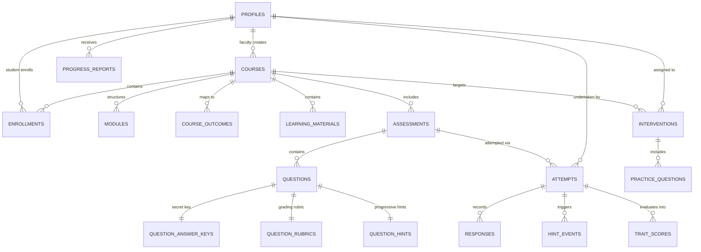

# AdaptiveLearn AI — Database Schema Specification

## 1. Overview
The database architecture is designed in PostgreSQL on Supabase. It uses UUID primary keys, foreign key constraints with cascade behaviors, strict domain check constraints, indexes on high-cardinality query paths, and comprehensive Row Level Security (RLS) policies.

Migration file: `supabase/migrations/20261113_initial_schema.sql`

---

## 2. Entity Relationship Diagram

---

## 3. Relational Tables

### 3.1 `profiles`
References Supabase `auth.users(id)`:
- `id` (UUID, PK)
- `email` (TEXT, UNIQUE)
- `full_name` (TEXT)
- `role` (TEXT: `'faculty'` | `'student'`)
- `institution` (TEXT, Default: `'Apex Institute of Technology'`)
- `avatar_url` (TEXT)
- `created_at`, `updated_at` (TIMESTAMPTZ)

### 3.2 `courses`
- `id` (UUID, PK)
- `faculty_id` (UUID, FK -> profiles.id)
- `code` (TEXT, e.g. `'CS301'`)
- `title` (TEXT)
- `description` (TEXT)
- `enrollment_code` (TEXT, UNIQUE, e.g. `'ML-2026'`)
- `academic_term` (TEXT)
- `is_archived` (BOOLEAN)

### 3.3 `enrollments`
- `id` (UUID, PK)
- `course_id` (UUID, FK -> courses.id)
- `student_id` (UUID, FK -> profiles.id)
- `enrolled_at` (TIMESTAMPTZ)
- *Constraint*: `UNIQUE(course_id, student_id)`

### 3.4 `modules` & `course_outcomes`
- `modules`: `id`, `course_id`, `title`, `description`, `order_index`
- `course_outcomes`: `id`, `course_id`, `code` (e.g. `'CO1'`), `description`

### 3.5 `learning_materials`
- `id` (UUID, PK)
- `course_id` (UUID, FK -> courses.id)
- `module_id` (UUID, FK -> modules.id)
- `uploader_id` (UUID, FK -> profiles.id)
- `filename` (TEXT)
- `storage_path` (TEXT)
- `file_type` (`'pdf'` | `'docx'` | `'pptx'` | `'ppt'` | `'txt'`)
- `file_size` (INTEGER)
- `extracted_text` (TEXT)
- `processing_status` (`'pending'` | `'processing'` | `'completed'` | `'failed'`)
- `approval_status` (`'pending'` | `'approved'` | `'rejected'`)
- `processing_error` (TEXT)

### 3.6 `assessments`
- `id` (UUID, PK)
- `course_id` (UUID, FK -> courses.id)
- `module_id` (UUID, FK -> modules.id)
- `title` (TEXT)
- `type` (`'diagnostic'` | `'module'` | `'practice'` | `'final'`)
- `instructions` (TEXT)
- `duration_minutes` (INTEGER)
- `total_marks` (NUMERIC)
- `passing_marks` (NUMERIC)
- `status` (`'draft'` | `'published'` | `'archived'`)
- `version` (INTEGER)
- `allow_hints` (BOOLEAN)

### 3.7 `questions` (Public Student-Facing Metadata)
- `id` (UUID, PK)
- `assessment_id` (UUID, FK -> assessments.id)
- `module_id` (UUID)
- `course_outcome_id` (UUID)
- `question_text` (TEXT)
- `question_type` (`'mcq'` | `'multiple_select'` | `'true_false'` | `'numeric'` | `'short_answer'` | `'long_answer'`)
- `options` (JSONB)
- `maximum_marks` (NUMERIC)
- `primary_trait` (`'Remembering'` | `'Understanding'` | `'Application'` | `'Analysis'` | `'Creativity'` | `'Evaluation'`)
- `secondary_trait` (`'Remembering'` | `'Understanding'` | `'Application'` | `'Analysis'` | `'Creativity'` | `'Evaluation'`)
- `difficulty` (`'easy'` | `'medium'` | `'hard'`)
- `order_index` (INTEGER)
- `status` (`'draft'` | `'generated'` | `'approved'` | `'rejected'`)
- `version` (INTEGER)

### 3.8 Secure Answer Keys, Rubrics & Hints (Restricted Server Access)
- `question_answer_keys`: `id`, `question_id` (UNIQUE), `correct_answer`, `reference_answer`, `accepted_variations` (JSONB), `numeric_tolerance`, `evaluation_method` (`'deterministic_exact'` | `'deterministic_numeric'` | `'concept_match'` | `'ai_rubric'`)
- `question_rubrics`: `id`, `question_id` (UNIQUE), `criteria` (JSONB `[{ description, marks }]`), `total_rubric_marks`, `ai_evaluation_prompt`
- `question_hints`: `id`, `question_id` (UNIQUE), `hint_1`, `hint_2`

### 3.9 Attempts, Responses & Hint Events
- `attempts`: `id`, `assessment_id`, `student_id`, `attempt_number`, `status` (`'in_progress'` | `'submitted'` | `'evaluated'`), `started_at`, `submitted_at`, `total_score`, `percentage`
- `responses`: `id`, `attempt_id`, `question_id`, `response_number` (1, 2, or 3), `submitted_answer`, `is_correct`, `awarded_marks`, `is_final`, `feedback`, `evaluator`, `confidence_score`
- `hint_events`: `id`, `attempt_id`, `question_id`, `hint_number` (1 or 2), `unlocked_at`, `response_number_triggered`
- `trait_scores`: `id`, `attempt_id`, `student_id`, `course_id`, `assessment_id`, `trait`, `earned_marks`, `max_marks`, `percentage_score`, `question_count`, `confidence_level`

### 3.10 Interventions & Practice
- `interventions`: `id`, `course_id`, `student_id`, `diagnostic_attempt_id`, `targeted_traits`, `targeted_outcomes`, `title`, `learning_gap_summary`, `content_package` (JSONB), `status` (`'generated'` | `'pending_approval'` | `'approved'` | `'rejected'` | `'released'`), `faculty_feedback`, `released_at`
- `practice_questions`: `id`, `intervention_id`, `question_text`, `question_type`, `options`, `correct_answer`, `explanation`
- `practice_attempts`: `id`, `practice_question_id`, `student_id`, `student_answer`, `is_correct`, `attempted_at`
- `progress_reports`: `id`, `course_id`, `student_id`, `baseline_assessment_id`, `final_assessment_id`, `baseline_overall_score`, `final_overall_score`, `overall_improvement_pp`, `trait_deltas`, `outcome_deltas`
